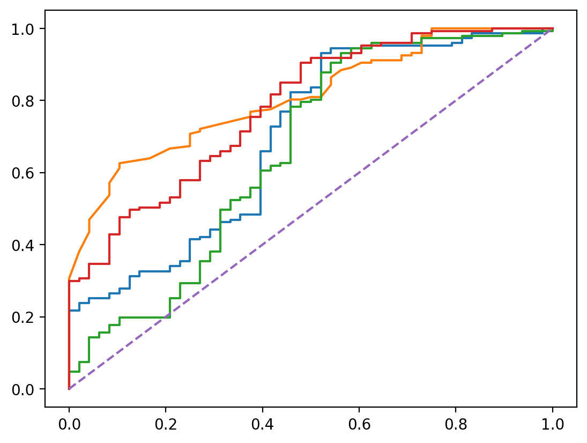

# Parkinson's Voice Screening Evaluation

Small machine-learning study on a public voice dataset (195 recordings from
32 people, 24 with Parkinson's and 8 healthy). The goal was not a high score but
an honest one. Educational project, not medical research.

## Key finding
The dataset has about six recordings per person. A random split puts the same
person in both training and test sets, which inflates the score:
random-split AUC [0.959] vs. person-wise AUC [0.745] (using random forest).

## Method
- Splits are made by person, never by recording (to prevent data leakage).
- Models: logistic regression, random forest, SVM, XGBoost (settings fixed in advance).
- 5 random repeats of 4-fold cross-validation; all predictions are out-of-fold.
- Metrics: ROC-AUC, and recall and specificity at different cut-offs.

## Results (person-wise, mean ± std over 5 seeds)
| Model | AUC |
|---|---|
| Random forest | [0.745 ± 0.052] |
| XGBoost | [0.759 ± 0.052] |
| Logistic regression | [0.722 ± 0.037] |
| SVM | [0.660 ± 0.058] |

Random forest at different cut-offs: 
|Threshold|Recall|Specificity|Flagged|
|---|---|---|---|
|0\.3|0\.9931972789115646|0\.25|182|
|0\.4|0\.9795918367346939|0\.2708333333333333|179|
|0\.5|0\.9523809523809523|0\.2708333333333333|175|
|0\.6|0\.9251700680272109|0\.3125|169|
|0\.7|0\.9047619047619048|0\.375|163|
|0\.8|0\.8027210884353742|0\.5416666666666666|140|

## Limitations
- Only 32 people (8 healthy): scores swing a lot depending on which people land in which fold.
- The three top models are statistically tied; only SVM is clearly worse.
- One data source, controlled recordings, no external validation.
- Not clinical evidence: this cannot show that a model reliably detects Parkinson's.

## Next steps
Person-level evaluation with confidence intervals, a permutation test,
and testing on a second dataset or raw audio.

## Credits
Dataset: UCI Parkinsons voice data (see data/README.md for the citation).
Built as a learning project with guidance from an AI.
